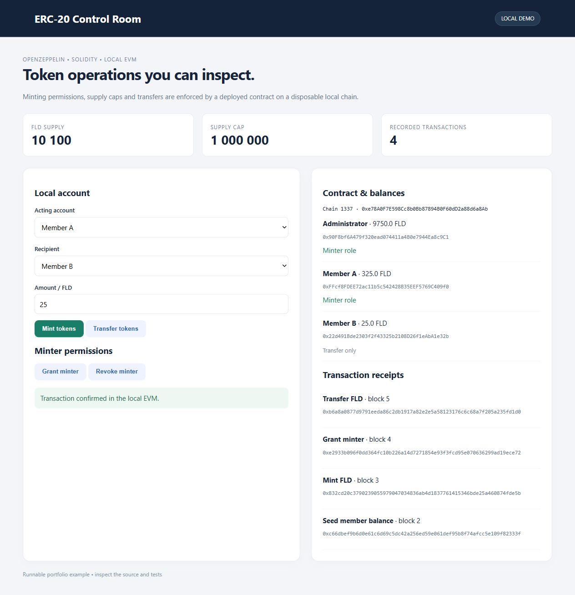

# ERC-20 Control Room

Mint, transfer and manage roles on a capped ERC-20 token in a local EVM.



## Run
Node.js 22+:
```sh
npm install
npm test
npm start
```
Open http://127.0.0.1:8765; `PORT` selects another port.

## Local EVM
Solidity is compiled at startup and deployed to a real in-process Ganache EVM (chain ID 1337). The dashboard signs transactions with disposable **local test accounts**; it never connects to a mainnet wallet. Receipt hashes and block numbers come from that local chain. State resets when the process restarts. This is not a public RPC endpoint or a browser-wallet integration.

## Contract behavior
`DemoToken.sol` composes OpenZeppelin ERC20Capped, ERC20Burnable and AccessControlDefaultAdminRules. Supply is limited to one million tokens. Only the minter role can mint. The administrator can grant/revoke that role; ordinary transfers enforce balances and allowances through ERC-20.

Tests compile and deploy the contract, verify unauthorized minting, supply-cap enforcement, role grant/revoke and transfers. The interface exercises the same contract; no balances are mocked in JavaScript. [OpenZeppelin access control](https://docs.openzeppelin.com/contracts/5.x/access-control).


## Scope
Portfolio demonstration, not audited. OpenZeppelin components are used, but their use does not audit this project. The admin delay is zero for the demo; real administration needs an appropriate delay and key management. No deployment to a public testnet or mainnet is performed. The local HTTP server is loopback-only and has no user authentication. Do not use its test accounts for real funds.
